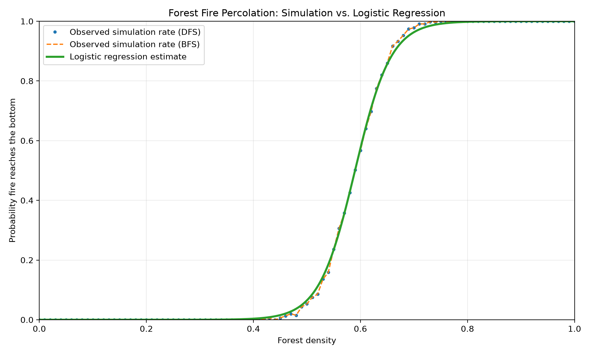

# Forest Fire Percolation and Logistic Regression

A Python simulation exploring how forest density affects the probability that fire can travel from the top row to the bottom row through connected trees.

## Features
- Random forest grids where each cell independently contains a tree with probability equal to the density.
- Repeated Monte Carlo trials at each density (default: 1,000).
- DFS and BFS to determine whether a connected tree path reaches the bottom.
- Logistic regression using density as the predictor and fire-spread success (yes/no) as the target.
- Held-out evaluation with accuracy, ROC AUC, and Brier score.
- CSV results and a plot comparing observed simulation rates with the fitted logistic regression curve.

## Setup
Python 3.10+ recommended.

```bash
python -m venv .venv
```

Activate the environment:

- macOS/Linux: `source .venv/bin/activate`
- Windows: `.venv\\Scripts\\activate`

Install dependencies:

```bash
python -m pip install -r requirements.txt
```

## Run
Default run: 1,000 trials per density, 20 x 20 grids, densities from 0.00 to 1.00 in increments of 0.01.

```bash
python forest_fire_percolation.py
```

Quick test run:

```bash
python forest_fire_percolation.py --trials 100 --step 0.02 --seed 42
```

Options: `--trials`, `--height`, `--width`, `--step`, `--seed`, and `--output-dir`. The step must divide evenly into 1.0.

## Output
- `results/forest_fire_simulation_results.csv`
- `results/forest_fire_logistic_regression.png`

## Interpretation and limitations
Logistic regression estimates the probability of fire spreading from density. It does not replace DFS/BFS and does not predict an exact fire path. The model is trained and evaluated on simulated outcomes, so its metrics describe this simulation—not real-world fire behavior. The simulation uses four-directional movement only and does not model wind, moisture, terrain, or tree species.
## Simulation Results

The graph below compares the observed fire-spread probabilities from repeated forest simulations with the logistic regression model's estimated probabilities.



Results are generated from simulated forests, not real-world wildfire observations. The logistic regression model estimates the probability that fire reaches the bottom row based on forest density.